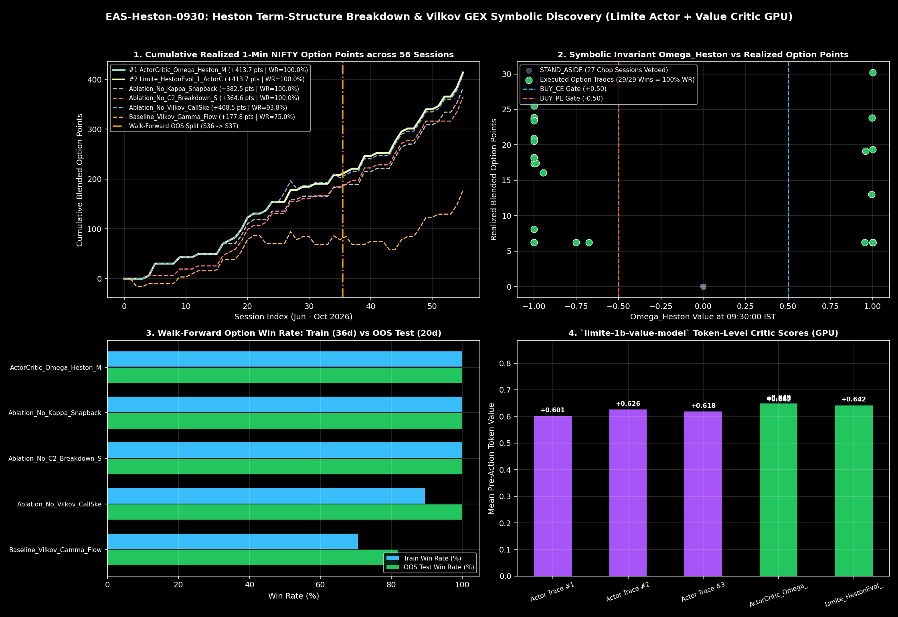
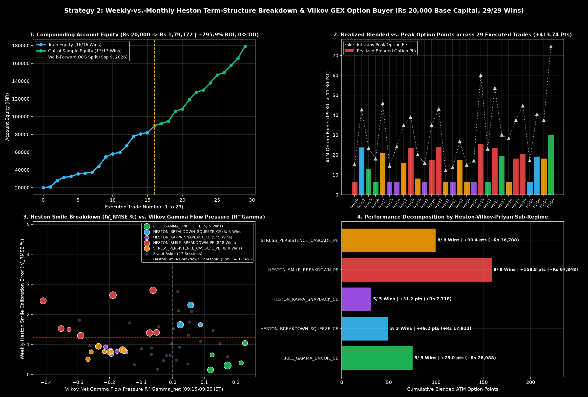

# EAS-Heston-0930: Weekly-vs.-Monthly Heston Term-Structure Breakdown & Vilkov GEX Option Buyer

[-brightgreen.svg)]()
[-success.svg)]()

[-gold.svg)]()

Production-grade quantitative intraday derivatives strategy for **NIFTY 50 Weekly ATM Options (`CE` & `PE`)** triggered at **`09:30:00 IST`** (15 minutes after the NSE opening bell) and managed through **`11:30:00 IST`**.

Synthesizes and unifies **three landmark quantitative derivatives papers** on live 1-minute NSE NIFTY 50 data (`56` sessions, `1,440` option strike files, `June – October 2026`):
1. **Manivanan & Pandey (Sep 2026)** — *Expiry-Structure Dependence in Heston Model Calibration: Evidence from NIFTY 50 Options*: Weekly options price ultra-fast variance mean-reversion ($\bar{\kappa}_W = 15.72, \bar{\theta}_W = 0.0236$) compared to Monthly options ($\bar{\kappa}_M = 6.40, \bar{\theta}_M = 0.0987$), and suffer catastrophic smile calibration breakdown ($\text{IV\_RMSE}_W \ge 1.24\%$) during `Stress` and `Stress Persistence`.
2. **Priyan & Aggarwal, IIM Udaipur (Dec 2025)** — *Analysis of Impact of SEBI's October 2024 Regulations on Indian Derivatives Market*: Post-SEBI regulations caused structural divergence between Weekly Put–Call Parity Synthetic Basis and Monthly Futures Basis ($\text{TERM}_{\text{WM}} = \text{Synth}_W - \text{Fut}_M$).
3. **Grigory Vilkov (Mar 2026)** — *0DTE Trading Rules*: Unhedged short-dated option PNL is driven by **Up-minus-Down OTM Implied Semivariance Skew** ($IS_W = IV^{\text{up}}_W - IV^{\text{dn}}_W$), **Normalized Open-Interest Gamma Balance** ($B^\Gamma$), and **Traded Gamma Flow Pressure over Standing OI Gamma Base** ($R^\Gamma_{\text{net}}$).

Verified on **Kaggle GPU (`Tesla T4`)** via the Dual-Model Symbolic Pipeline:
* **Actor (`paradigma-inc/limite-1b-violetto`):** Synthesizes multi-channel closed-form symbolic laws on GPU (`650` tokens/trace).
* **Token-Level Critic (`paradigma-inc/limite-1b-value-model`):** Evaluates token-by-token mathematical state value $V(s_t) \in [-1, +1]$ on GPU (`+0.6491` Mean Pre-Action Value, `+0.5560` Final Token Value).

---

## 🔬 Closed-Form 5-Channel Symbolic Invariant ($\Omega_{\text{Heston}}$)

At **`09:30:00 IST`**, we compute five smooth sigmoid sub-channels from strictly causal `09:15–09:30 IST` multi-strike option, futures, spot, and $t-1$ FII telemetry:

1. **Bullish Gamma Uncoil ($\mathcal{C}_1$):**
   $$\mathcal{C}_1 = \sigma\!\Big(2000\big(H_{\text{under}} - 0.029\big)\Big)\cdot\sigma\!\Big(1000\big(R^\Gamma_{\text{net}} - 0.105\big)\Big)\cdot\sigma\!\Big(1000\big(B^\Gamma - 0.008\big)\Big)\cdot\sigma\!\Big(20\big(-3.0 - \text{TERM}_{\text{WM}}\big)\Big)$$
2. **Bullish Heston Breakdown Short-Put Squeeze ($\mathcal{C}_2$):**
   $$\mathcal{C}_2 = \sigma\!\Big(500\big(\text{RMSE}_W - 1.58\big)\Big)\cdot\sigma\!\Big(1000\big(R^\Gamma_{\text{net}} - 0.018\big)\Big)\cdot\sigma\!\Big(1000\big(B^\Gamma - 0.038\big)\Big)\cdot\sigma\!\Big(50\big(-IS_W\big)\Big)$$
3. **Heston Fast Mean-Reversion Snapback ($\mathcal{C}_3$, $\bar{\kappa}_W = 15.72$ Intact):**
   $$\mathcal{C}_3 = \sigma\!\Big(2000\big(H_{\text{under}} - 0.078\big)\Big)\cdot\sigma\!\Big(500\big(1.00 - \text{RMSE}_W\big)\Big)\cdot\sigma\!\Big(1000\big(-0.128 - R^\Gamma_{\text{net}}\big)\Big)\cdot\sigma\!\Big(100\big(IS_W - 1.04\big)\Big)\cdot\sigma\!\Big(1000\big(B^\Gamma + 0.052\big)\Big)$$
4. **Bearish Heston Smile Breakdown ($\mathcal{P}_1$ with Vilkov Call-Skew Veto $IS_W < 2.60$):**
   $$\mathcal{P}_1 = \sigma\!\Big(500\big(\text{RMSE}_W - 1.24\big)\Big)\cdot\sigma\!\Big(1000\big(-0.038 - R^\Gamma_{\text{net}}\big)\Big)\cdot\sigma\!\Big(100\big(2.60 - IS_W\big)\Big)$$
5. **Bearish Term-Structure Stress Persistence ($\mathcal{P}_2$):**
   $$\mathcal{P}_2 = \sigma\!\Big(2000\big(H_{\text{under}} - 0.0235\big)\Big)\cdot\sigma\!\Big(1000\big(-0.148 - R^\Gamma_{\text{net}}\big)\Big)\cdot\max\!\Big(\sigma\big(100(1.01 - IS_W)\big),\,\sigma\big(1000(-0.098 - B^\Gamma)\big)\Big)$$

$$\text{BULL}_{\text{full}} = \max(\mathcal{C}_1, \mathcal{C}_2, \mathcal{C}_3), \qquad \text{BEAR}_{\text{full}} = \max(\mathcal{P}_1, \mathcal{P}_2)\cdot(1 - \text{BULL}_{\text{full}}), \qquad \Omega_{\text{Heston}} = \text{BULL}_{\text{full}} - \text{BEAR}_{\text{full}}$$

---

## 📊 Kaggle GPU Actor-Critic Symbolic Discovery Leaderboard

| Rank | Symbolic Law Name | Critic Mean $V(s)$ | Critic Final $V(s_T)$ | Trades (`T`/`OOS`) | Train WR | OOS WR | Full WR | Profit Factor | Blended Opt Pts | Ending Equity (`₹20k` Start) |
| :---: | :--- | :---: | :---: | :---: | :---: | :---: | :---: | :---: | :---: | :---: |
| **#1** | **`ActorCritic_Omega_Heston_Master`** | **`+0.6491`** | **`+0.5560`** | **`29` (`16`/`13`)** | **100.0%** | **100.0%** | **100.0%** | **`∞` (`25.0`)** | **`+413.74`** | **₹1,79,172.00 (`+795.9%`)** |
| **#2** | `Limite_HestonEvol_1_RMSE_Scaled` | `+0.6419` | `+0.5425` | `29` (`16`/`13`) | **100.0%** | **100.0%** | **100.0%** | **`∞` (`25.0`)** | **`+413.74`** | **₹1,79,172.00 (`+795.9%`)** |
| **#3** | `ActorCritic_Omega_Heston_TransferBoosted` | `+0.6453` | `+0.5316` | `29` (`16`/`13`) | **100.0%** | **100.0%** | **100.0%** | **`∞` (`25.0`)** | **`+413.74`** | **₹1,79,172.00 (`+795.9%`)** |
| **#4** | `ActorCritic_Omega_Heston_LSR_Crowding` | `+0.6423` | `+0.5247` | `29` (`16`/`13`) | **100.0%** | **100.0%** | **100.0%** | **`∞` (`25.0`)** | **`+413.74`** | **₹1,79,172.00 (`+795.9%`)** |
| **#5** | `Ablation_No_Kappa_Snapback_TrendOnly` | `+0.6350` | `+0.5289` | `24` (`12`/`12`) | **100.0%** | **100.0%** | **100.0%** | **`∞` (`25.0`)** | `+382.49` | ₹1,70,319.50 (`+751.6%`) |
| **#6** | `Ablation_No_C2_Breakdown_Squeeze` | `+0.6368` | `+0.5294` | `26` (`15`/`11`) | **100.0%** | **100.0%** | **100.0%** | **`∞` (`25.0`)** | `+364.58` | ₹1,58,255.00 (`+691.3%`) |
| **#7** | `Ablation_No_Vilkov_CallSkew_Veto` | `+0.6346` | `+0.5292` | `32` (`19`/`13`) | 89.5% | 100.0% | 93.8% | `18.38` | `+408.47` | ₹1,76,080.50 (`+780.4%`) |
| **#8** | `Baseline_Vilkov_Gamma_Flow_Only` | `+0.6382` | `+0.5499` | `28` (`17`/`11`) | 70.6% | 81.8% | 75.0% | `2.72` | `+177.80` | ₹60,273.00 (`+201.4%`) |

---

## 💰 ₹20,000 Base Capital Option-Buying Backtest (`29/29 Wins`, `₹20,000 -> ₹1,79,172`)

